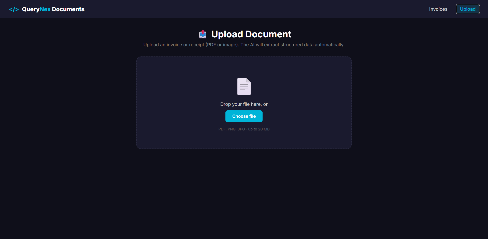
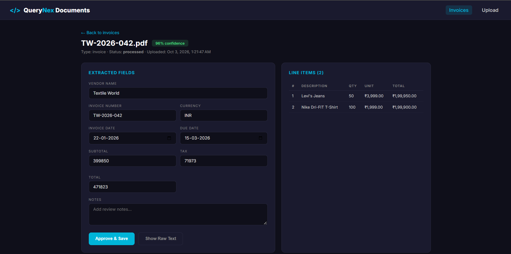
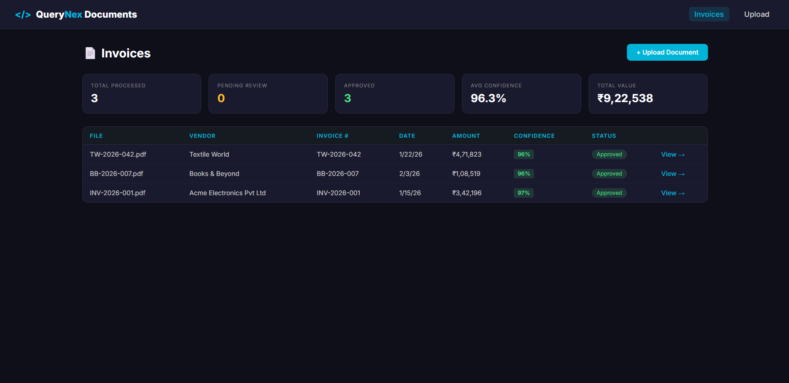
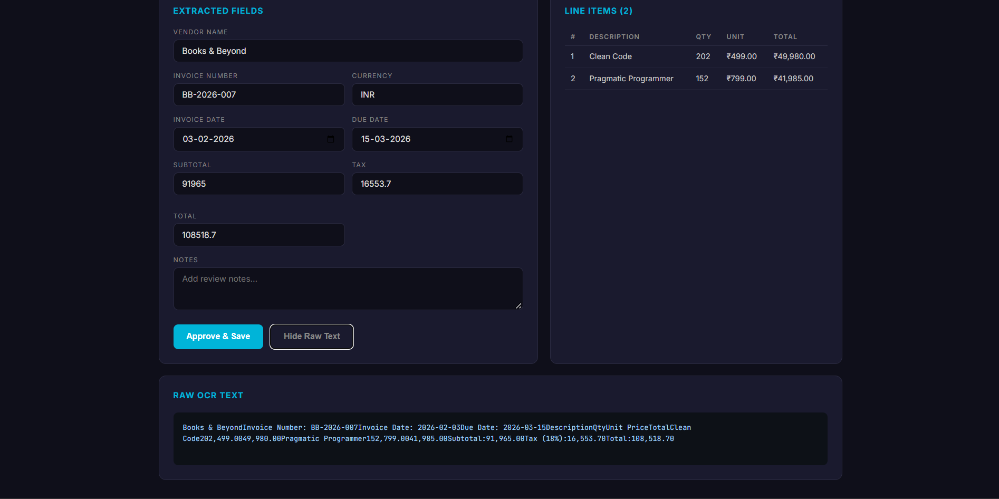

# Intelligent Document Processing

> AI-powered invoice and receipt extraction with confidence scoring, human review, and a full review dashboard.

[](https://dotnet.microsoft.com)
[](https://angular.io)
[](https://www.postgresql.org)
[](https://groq.com)
[](LICENSE)

Upload a PDF or image of an invoice. In seconds, the AI extracts the vendor, invoice number, dates, line items, and totals — with per-field confidence scores. Low-confidence fields are flagged for human review. Approve with one click and the invoice is stored in PostgreSQL.

This is a **production-style AP automation workflow** built with the same stack as the rest of the QueryNex portfolio suite.

---

## 📸 Screenshots

| Upload & Processing | Invoice Detail & Review |
|---------------------|-------------------------|
|  |  |

| Invoice List & KPIs | Raw OCR Text |
|---------------------|--------------|
|  |  |

---

## ✨ Features

- 📤 **Drag-and-Drop Upload** — PDF and image support (up to 20 MB)
- 📝 **PDF Text Extraction** — Uses PdfPig for clean text without external services
- 🖼️ **OCR for Images** — Tesseract for scanned invoices and receipts
- 🤖 **AI Structured Extraction** — Groq parses raw text into typed JSON
- 📊 **Per-Field Confidence** — Know exactly which fields the AI is unsure about
- 👁️ **Human-in-the-Loop Review** — Edit any field and approve with one click
- 🧾 **Line Item Extraction** — Description, quantity, unit price, total per row
- 📈 **Dashboard KPIs** — Total processed, pending review, approved, avg confidence, total value
- 🔍 **Raw OCR Viewer** — Toggle to see what the AI actually saw
- 🎨 **Modern Angular 22 UI** — Signals, standalone components, `@if`/`@for`, OnPush
- 🔐 **Secret Management** — Groq key and DB credentials in .NET User Secrets

---

## 🏗️ Architecture

```
┌────────────────────────────────────────────────────────────┐
│                    Angular 22 Frontend                     │
│  ┌───────────────┐  ┌────────────────┐  ┌──────────────┐  │
│  │ Upload Panel  │  │ Invoices List  │  │ Invoice      │  │
│  │ (drag-drop)   │  │ (KPIs + table) │  │ Detail       │  │
│  └───────────────┘  └────────────────┘  └──────────────┘  │
└──────────────────────────┬─────────────────────────────────┘
                           │ HTTP
                           ▼
┌────────────────────────────────────────────────────────────┐
│                  .NET 10 Web API                           │
│                                                            │
│  ┌─────────────────────┐  ┌──────────────────────────────┐│
│  │ DocumentsController │  │ PdfExtractionService         ││
│  │ ─ POST /upload      │  │  (UglyToad.PdfPig)           ││
│  │ ─ GET  /{id}        │  └──────────────────────────────┘│
│  │ ─ PUT  /{id}        │  ┌──────────────────────────────┐│
│  │ ─ GET  /stats       │  │ OcrService (Tesseract)       ││
│  └─────────────────────┘  └──────────────────────────────┘│
│                                                            │
│  ┌──────────────────────┐  ┌──────────────────────────────┐│
│  │ InvoiceExtraction    │  │ InvoiceService               ││
│  │ (Groq → JSON)        │  │ (Npgsql persistence)         ││
│  └──────────────────────┘  └──────────────────────────────┘│
└──────────────────────────┬─────────────────────────────────┘
                           │
                           ▼
┌────────────────────────────────────────────────────────────┐
│      PostgreSQL (Neon) — reuses the e-commerce DB          │
│  Existing: customers, orders, products, categories…        │
│  New:      invoices, invoice_line_items, extraction_fields │
└────────────────────────────────────────────────────────────┘
```

**Request flow:**

1. User drops a PDF/image in the Angular upload panel
2. Backend extracts raw text (PdfPig for PDFs, Tesseract for images)
3. Raw text + a strict JSON schema prompt are sent to Groq
4. Groq returns structured JSON with per-field confidence scores
5. Backend persists invoice + line items to PostgreSQL
6. Low-confidence fields are flagged for review; high-confidence ones are auto-approved
7. Dashboard aggregates KPIs from the `invoices` table

---

## 🛠️ Tech Stack

| Layer | Technology | Version |
|-------|-----------|---------|
| **Frontend** | Angular (Standalone + Signals) | 22 |
| **Backend** | .NET Core Web API | 10 |
| **Database** | PostgreSQL | 16+ |
| **PDF Parsing** | UglyToad.PdfPig | Latest |
| **OCR** | Tesseract (via `Tesseract` NuGet) | 5.x |
| **AI Extraction** | Groq (OpenAI-compatible API) | `openai/gpt-oss-120b` |
| **DB Driver** | Npgsql | Latest |

---

## 📁 Project Structure

```
ai-document-processor/
├── WebAPI/
│   └── DocumentProcessor.Api/
│       ├── Controllers/
│       │   └── DocumentsController.cs
│       ├── Models/
│       │   └── Dtos.cs
│       ├── Services/
│       │   ├── PdfExtractionService.cs
│       │   ├── OcrService.cs
│       │   ├── InvoiceExtractionService.cs
│       │   └── InvoiceService.cs
│       ├── tessdata/
│       │   └── eng.traineddata
│       ├── Program.cs
│       └── appsettings.json
├── document-processor-ui/
│   └── src/
│       └── app/
│           ├── upload/
│           │   ├── upload.ts
│           │   ├── upload.html
│           │   └── upload.css
│           ├── invoices/
│           │   ├── invoices.ts
│           │   ├── invoices.html
│           │   └── invoices.css
│           ├── invoice-detail/
│           │   ├── invoice-detail.ts
│           │   ├── invoice-detail.html
│           │   └── invoice-detail.css
│           ├── document.service.ts
│           ├── app.ts
│           ├── app.config.ts
│           └── app.routes.ts
├── database/
│   └── 06_document_processing.sql
├── docs/
│   └── screenshots/
├── .gitignore
├── LICENSE
└── README.md
```

---

## 🚀 Getting Started

### Prerequisites

- [.NET 10 SDK](https://dotnet.microsoft.com/download/dotnet/10.0)
- [Node.js 22.12+](https://nodejs.org)
- [Angular CLI 22+](https://angular.io/cli) (`npm install -g @angular/cli@latest`)
- [PostgreSQL 16+](https://www.postgresql.org/download/) — or a free [Neon](https://neon.tech) account
- [Groq API Key](https://console.groq.com) — free, no credit card
- **Optional:** Python 3 + `reportlab` (for generating test invoices)

---

### 1️⃣ Database Setup

This project **reuses the e-commerce database** from the AI SQL Query Generator and AI Support Agent projects.

**Load the document processing schema:**

```bash
psql "postgresql://...neon.tech/neondb?sslmode=require" -f database/06_document_processing.sql
```

This creates three new tables:

| Table | Purpose |
|-------|---------|
| `invoices` | Header data (vendor, number, dates, totals, confidence, status) |
| `invoice_line_items` | Extracted line items (description, qty, unit price, total) |
| `extraction_fields` | Audit trail for field-level edits (future enhancement) |

The schema **references** existing `orders` and `products` tables so invoices can be linked to the e-commerce dataset later.

---

### 2️⃣ Backend Setup

```powershell
cd WebAPI/DocumentProcessor.Api
dotnet restore
dotnet user-secrets init
```

**Configure secrets:**

```powershell
dotnet user-secrets set "Groq:ApiKey" "gsk_your_actual_key"
dotnet user-secrets set "ConnectionStrings:DefaultConnection" `
  "Host=ep-xxx.neon.tech;Port=5432;Database=neondb;Username=neondb_owner;Password=...;SSL Mode=Require;Trust Server Certificate=true"
```

**Verify secrets:**

```powershell
dotnet user-secrets list
```

**Optional — Set up Tesseract for image OCR:**

Download `eng.traineddata` from [github.com/tesseract-ocr/tessdata](https://github.com/tesseract-ocr/tessdata/raw/main/eng.traineddata) and place it at:

```
WebAPI/DocumentProcessor.Api/tessdata/eng.traineddata
```

Skip this step if you only plan to upload PDFs — PDF extraction works without it.

**Run the API:**

```powershell
dotnet run --launch-profile https
```

API runs at `https://localhost:7249` (check `launchSettings.json`).
Swagger UI: `https://localhost:7249/swagger`

---

### 3️⃣ Frontend Setup

```powershell
cd document-processor-ui
npm install
```

**Update the API URL** in `src/environments/environment.development.ts`:

```typescript
export const environment = {
  production: false,
  apiBase: 'https://localhost:7249/api'
};
```

**Run the dev server:**

```powershell
ng serve --open
```

Frontend runs at `http://localhost:4200`.

---

### 4️⃣ Generate Sample Invoices

No need to source real invoices — generate a few with Python and ReportLab.

```bash
pip install reportlab
```

Save this as `generate_invoices.py`:

```python
from reportlab.lib.pagesizes import letter
from reportlab.pdfgen import canvas

invoices = [
    {"vendor": "Acme Electronics Pvt Ltd", "num": "INV-2026-001", "date": "2026-01-15",
     "items": [("iPhone 15 Pro", 1, 129999), ("Samsung Galaxy S24", 2, 79999)]},
    {"vendor": "Textile World", "num": "TW-2026-042", "date": "2026-01-22",
     "items": [("Levi's Jeans", 50, 3999), ("Nike Dri-FIT T-Shirt", 100, 1999)]},
    {"vendor": "Books & Beyond", "num": "BB-2026-007", "date": "2026-02-03",
     "items": [("Clean Code", 20, 2499), ("Pragmatic Programmer", 15, 2799)]},
]

for inv in invoices:
    filename = f"{inv['num']}.pdf"
    c = canvas.Canvas(filename, pagesize=letter)
    c.setFont("Helvetica-Bold", 20)
    c.drawString(50, 750, inv["vendor"])
    c.setFont("Helvetica", 11)
    c.drawString(50, 730, f"Invoice Number: {inv['num']}")
    c.drawString(50, 715, f"Invoice Date: {inv['date']}")
    c.drawString(50, 700, "Due Date: 2026-03-15")

    y = 650
    c.setFont("Helvetica-Bold", 12)
    c.drawString(50, y, "Description")
    c.drawString(350, y, "Qty")
    c.drawString(420, y, "Unit Price")
    c.drawString(510, y, "Total")
    y -= 20

    subtotal = 0
    c.setFont("Helvetica", 11)
    for desc, qty, price in inv["items"]:
        total = qty * price
        subtotal += total
        c.drawString(50, y, desc)
        c.drawString(350, y, str(qty))
        c.drawString(420, y, f"{price:,.2f}")
        c.drawString(510, y, f"{total:,.2f}")
        y -= 18

    tax = subtotal * 0.18
    grand = subtotal + tax

    y -= 20
    c.setFont("Helvetica-Bold", 11)
    c.drawString(420, y, "Subtotal:"); c.drawString(510, y, f"{subtotal:,.2f}")
    y -= 18
    c.drawString(420, y, "Tax (18%):"); c.drawString(510, y, f"{tax:,.2f}")
    y -= 18
    c.setFont("Helvetica-Bold", 13)
    c.drawString(420, y, "Total:"); c.drawString(510, y, f"{grand:,.2f}")

    c.save()
    print(f"Generated {filename}")
```

Run:

```bash
python generate_invoices.py
```

---

### 5️⃣ Test the Flow

1. Open `http://localhost:4200`
2. Click **Upload**
3. Drop a generated PDF into the upload zone
4. Wait 5–10 seconds — the AI processes and extracts
5. You'll be redirected to the invoice detail page
6. Review the extracted fields and confidence score
7. Edit any field if needed, add notes, click **Approve & Save**
8. Return to **Invoices** to see the dashboard update

---

## 🔌 API Reference

### `POST /api/documents/upload`

Upload a PDF or image file for extraction.

**Request:** `multipart/form-data` with field `file`.

**Response:**
```json
{
  "invoiceId": 12,
  "success": true,
  "overallConfidence": 0.92,
  "error": null
}
```

---

### `GET /api/documents`

List all invoices (optionally filtered by status).

**Query params:** `?status=needs_review` (optional)

**Response:**
```json
[
  {
    "invoiceId": 12,
    "filename": "INV-2026-001.pdf",
    "documentType": "invoice",
    "vendorName": "Acme Electronics Pvt Ltd",
    "invoiceNumber": "INV-2026-001",
    "invoiceDate": "2026-01-15T00:00:00Z",
    "totalAmount": 305997.00,
    "status": "processed",
    "confidenceScore": 0.92,
    "uploadedAt": "2026-02-03T10:23:00Z"
  }
]
```

---

### `GET /api/documents/{id}`

Fetch full invoice detail including line items and raw OCR text.

---

### `PUT /api/documents/{id}`

Update fields and mark the invoice as approved.

**Request:**
```json
{
  "vendorName": "Acme Electronics Pvt Ltd",
  "invoiceNumber": "INV-2026-001",
  "invoiceDate": "2026-01-15",
  "dueDate": "2026-03-15",
  "subtotal": 259320.00,
  "taxAmount": 46677.60,
  "totalAmount": 305997.60,
  "currency": "INR",
  "notes": "Verified against PO #4521"
}
```

**Response:** `204 No Content`

---

### `GET /api/documents/stats`

Dashboard KPIs.

**Response:**
```json
{
  "totalInvoices": 42,
  "pendingReview": 5,
  "approved": 35,
  "averageConfidence": 0.87,
  "totalValue": 12450000.00
}
```

---

## 🤖 How AI Extraction Works

Unlike free-form SQL generation, this project uses **structured JSON extraction** with a strict schema:

1. **Raw text in** — PdfPig (or Tesseract) provides the plain text
2. **Strict prompt out** — Backend sends a prompt with a fixed JSON schema
3. **JSON mode** — Groq's `response_format: json_object` guarantees valid JSON
4. **Parsed in C#** — `JsonNode` gives typed access to every field
5. **Confidence tracked** — The AI returns 0.0–1.0 per field
6. **Auto-flagging** — Anything under 0.75 is marked `needs_review`

**Why this pattern is production-safe:**

| Risk | Mitigation |
|------|-----------|
| Invalid JSON | `response_format: json_object` |
| Hallucinated values | Explicit "use null if not present" instruction |
| Wrong field types | Typed DTO parsing with `try/catch` per field |
| Silent errors | Confidence scores surface uncertainty |
| Data modification | No DELETE/UPDATE — extraction only inserts |

---

## 🗄️ Database Schema

### New Tables

| Table | Purpose |
|-------|---------|
| `invoices` | Document header (vendor, invoice #, dates, amounts, status, confidence) |
| `invoice_line_items` | Per-line detail (description, qty, unit price, total, confidence) |
| `extraction_fields` | Audit trail for field edits (reserved for future use) |

### Reused Tables

| Table | Used For |
|-------|---------|
| `orders` | Optional link: invoice → matching purchase order |
| `products` | Optional link: line item → catalog product |
| `customers` | Vendor/customer context |

---

## 🔒 Security

| Protection | Implementation |
|------------|---------------|
| **File size limit** | `[RequestSizeLimit(20_000_000)]` — 20 MB cap |
| **MIME type check** | Only PDFs and images accepted |
| **Secrets** | .NET User Secrets; never committed |
| **Parameterized SQL** | Npgsql parameters everywhere |
| **Read-only AI** | No AI-generated SQL is ever executed |
| **CORS** | Restricted to `http://localhost:4200` |

---

## 🧗 Challenges Solved

- **PDF text extraction** — Chose PdfPig over PdfSharp for cleaner text output and simpler API
- **Structured JSON from LLM** — Combined explicit schema prompt + Groq's `response_format: json_object` to guarantee valid JSON
- **Duplicate SQL parameter names** — Hit `COALESCE types integer and date cannot be matched`; fixed by giving every placeholder a unique name (`@invoiceId`, `@invDate`, `@invNum`)
- **Confidence-based routing** — Documents with confidence < 0.75 auto-flag as `needs_review`; higher-confidence ones go straight to `processed`
- **Tesseract optional** — Made OCR a soft dependency so PDF-only setups work without extra downloads
- **Modern Angular** — Signals, standalone components, `@if`/`@for`, OnPush change detection

---

## ☁️ Deployment

| Component | Recommended Service | Free Tier |
|-----------|--------------------|-----------|
| **Frontend** | Azure Static Web Apps | 500 MB, 100 GB bandwidth |
| **Backend** | Azure App Service (F1) | 1 GB disk, 60 min CPU/day |
| **Database** | Neon | 0.5 GB, auto-suspend |
| **AI** | Groq | Generous free tier |

**Deployment notes:**

- **Tesseract language data** — Bundle `eng.traineddata` in the deployment package (add `<Content Include="tessdata\**" CopyToOutputDirectory="PreserveNewest" />` to the `.csproj`)
- **App Service env vars** — Set `Groq__ApiKey` and `ConnectionStrings__DefaultConnection` in Configuration → Application settings (use double underscore for nesting)
- **Update `environment.ts`** — Point to the production API URL before building the Angular app

---

## 🧪 Sample Test Cases

| Invoice Type | Expected Behavior |
|--------------|-------------------|
| Clean digital PDF | High confidence (>0.9), auto-approved |
| Scanned PDF (image only) | Requires OCR; medium confidence |
| Handwritten receipt (image) | Low confidence; flagged for review |
| Invoice with missing due date | `dueDate = null`; other fields unaffected |
| Multi-page PDF | All pages concatenated before extraction |
| JPG/PNG invoice | Tesseract kicks in automatically |

---

## 🤝 Contributing

Contributions, issues, and feature requests are welcome!

1. Fork the repository
2. Create a feature branch (`git checkout -b feature/amazing-feature`)
3. Commit your changes (`git commit -m 'Add amazing feature'`)
4. Push the branch (`git push origin feature/amazing-feature`)
5. Open a Pull Request

---

## 📄 License

This project is licensed under the MIT License — see the [LICENSE](LICENSE) file for details.

---

## 👤 Author

**QueryNex**
- Portfolio: [querynexai.github.io](https://querynexai.github.io)
- GitHub: [@querynexai](https://github.com/querynexai)
- Email: querynex.ai@outlook.com

---

## ⭐ Show Your Support

If this project helped you, please give it a star ⭐ — it helps others discover it too.

---

## 🙏 Acknowledgements

- [UglyToad.PdfPig](https://github.com/UglyToad/PdfPig) for reliable PDF text extraction in .NET
- [Tesseract](https://github.com/tesseract-ocr/tesseract) for open-source OCR
- [Groq](https://groq.com) for fast, free LLM inference
- [Neon](https://neon.tech) for serverless PostgreSQL
- The open-source .NET, Angular, and PostgreSQL communities

---

## 🎯 Project Status

| Component | Status |
|-----------|--------|
| PDF text extraction | ✅ Working |
| Image OCR (Tesseract) | ✅ Working |
| AI structured extraction | ✅ Working |
| Confidence scoring | ✅ Working |
| Human review & edit | ✅ Working |
| Line item parsing | ✅ Working |
| Dashboard KPIs | ✅ Working |
| Raw OCR viewer | ✅ Working |
| README + LICENSE | ✅ Ready |